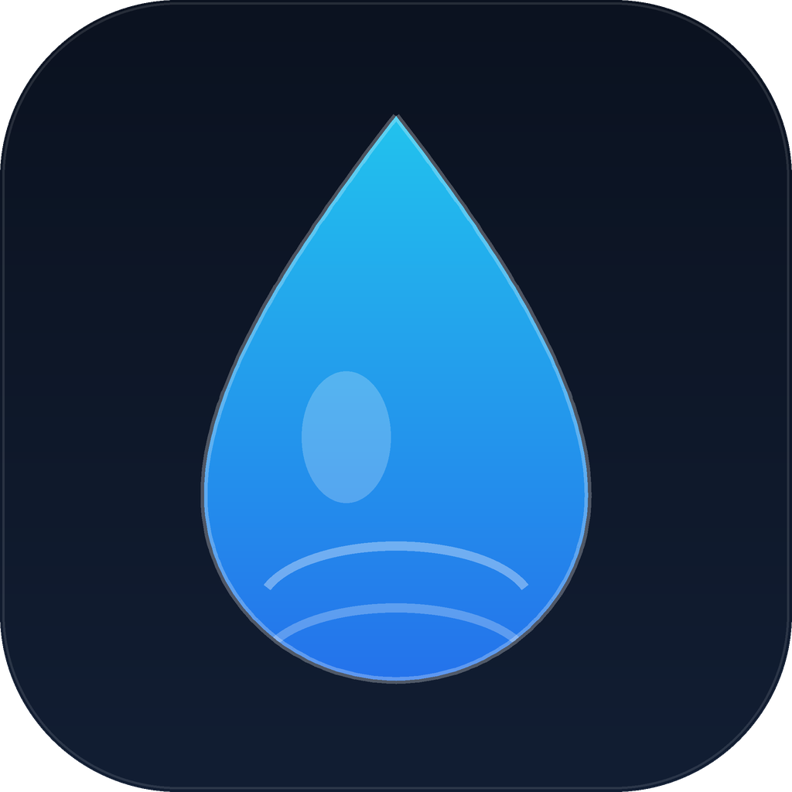

# WaterValveBLE · 蓝牙水控

KLCXKJ-Water（base42）蓝牙水表的本地控制客户端：Flask + pywebview 界面、BLE 协议实现、零用量结算，以及一套防止“开着水关机后继续扣费”的安全看门狗。

> Windows 安装包：[Releases](https://github.com/lc655254/water-valve-ble/releases/latest)（per-user，无需管理员，onedir 负载）

> 仅用于自己有权控制的设备与本地学习/互操作研究。协议为逆向所得，与设备厂商无关联；计费与账号规则以厂商为准，使用风险自负。

## 功能

- 蓝牙扫描 / 连接 / 设备身份校验（deviceId 不匹配拒绝开阀）
- 云端下单开阀、关阀、零用量结算（上报 0 用量，账单 0 元）
- 本地账本、云端账单查询、余额/订单查看
- 命令行与 Web 界面共用同一套安全控制台
- 安全层：会话落盘、心跳、超时/费用上限自动关阀、启动自愈
- Windows 关机 / 注销 / 重启 / 休眠 / Alt+F4 前先零用量关阀
- 独立看门狗：主程序被杀、崩溃、断电重启后自动收尾

## 安全设计（摘要）

1. 开阀前把 `state=opening` 写入 `valve_session.json`（pid / boot_ts / deadline），确认后 `open`，关完 `closed`。
2. 心跳用 `valve_heartbeat` 的 mtime，避免定时重写 JSON。
3. 主程序内 watchdog：超过 `max_open_minutes` 或预计费用超过 `max_cost_yuan`，自动零用量关阀。
4. 外部看门狗 `valve_guard.py`：主进程死亡、心跳超时、重启后接管；空闲时不加载 BLE。
5. Windows 窗口子类化：拦截 `WM_QUERYENDSESSION` / `WM_POWERBROADCAST` / `WM_CLOSE`，先关阀再放行。
6. 登录自启动写在 `HKCU\Software\Microsoft\Windows\CurrentVersion\Run`（Unicode，中文路径不会乱码）。

详细行为矩阵、配置、自检与残余风险见 [docs/说明.md](docs/说明.md)。

## 快速开始

要求：Windows 10/11、Python 3.10+、蓝牙适配器、WebView2 Runtime。

```bat
python -m pip install -r requirements.txt
copy config.example.json config.json
python WaterValveBLE_Web.py
```

首次启动按界面提示用手机号 + 验证码登录；登录态只保存在本机 `config.json`，该文件已被 `.gitignore` 排除。

也可以双击：

- `1-启动(控制台).bat`：带控制台，推荐排查问题
- `2-启动(无窗口).bat`：pythonw 启动
- `开水.bat` / `关水.bat`：通过本机安全控制台执行（控制台不在会自动拉起）

## 配置

`config.json` 由 `config.example.json` 复制而来，常用字段：

```json
{
  "mode": "ble",
  "max_open_minutes": 20,
  "max_cost_yuan": 3.0
}
```

- `max_open_minutes`：最长连续放水时间，到点自动关阀
- `max_cost_yuan`：按 12 L/min 保守估算的费用上限，到点自动关阀

## 自检

```bat
python safety_selftest.py --data-dir %TEMP%\wv_safety_test
```

覆盖会话落盘、关阀状态机、启动自愈、开阀闸门、`WM_QUERYENDSESSION`、`WM_CLOSE`、假 BLE 看门狗结算。不碰真表、不关机。

## 打包

```bat
python -m pip install pyinstaller
build_onedir.bat
```

PyInstaller **onedir**（不是 onefile）：启动不用解压临时目录，实测本地 API 约 0.4 秒就绪。产物在 `dist\蓝牙水库安全版\`。

## 目录

```
WaterValveBLE_v4.py      BLE 协议 / 云端接口 / 结算 / CLI
WaterValveBLE_Web.py     Flask + pywebview 界面与安全层集成
valve_safety.py          会话日志 / 心跳 / 关机休眠拦截 / 启动自愈
valve_guard.py           独立看门狗
safety_selftest.py       安全层自检
开关水.py / tap.py       命令行开关水（走安全控制台）
web/                     前端
docs/说明.md             详细逆向记录、行为矩阵、配置与残余风险
```

## 已知边界

- 拔电瞬间无法执行关阀，设备自身预扣（默认 5 元）是硬件上限；下次登录看门狗会零用量清账。
- 水表不在蓝牙范围时看门狗会重试，连上之前水会继续流。
- 用手机官方 App 去关本程序开的单，会按真实用量结算；正确顺序是先让本程序/看门狗零用量关阀。
- 不同固件/型号的帧格式可能不同，代码里的 `base42` 适配不保证覆盖所有批次。

## License

MIT
